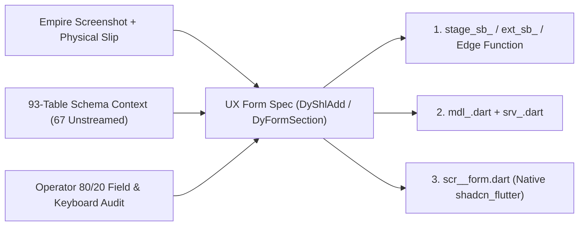

# Empire Replacement Intake System: Users, Workflows & 93-Table Schema Harvester

> **Purpose**: Feed real-world **Empire (AMAZE MSSQL)** operator behavior, legacy form screenshots, and the remaining **67 unstreamed SQL table schemas** directly into Antigravity so we can design superior `DyShlAdd` / `DyFormSection` UX forms and replace Empire 100%.

---

## Why This System Exists

Currently, **26 core tables** (`sq_BILLS`, `sq_BILLDET`, `sq_MILLREC`, `sq_PINVTRN`, `sq_CHALTRN`, `sq_MASTER`, `sq_QUAL`, `sq_SERIES`, `sq_FAS`, `sq_RECPAY`, etc.) are streamed via Airbyte into `IMMBE2627`.
However, AMAZE/Empire has **93 tables in total** (~67 of which are empty or rarely populated). Even when a legacy table has `0 rows`, its **column names, data types, and defaults** act as an X-ray of Empire's form inputs, checkboxes, and business rules.

Instead of polluting Airbyte and Supabase with 67 empty `sq_` mirrors, this intake system captures:
1. **The Full 93-Table Blueprint** (via a 5-second local SQL metadata export).
2. **Real Operator Muscle Memory** (who uses Empire, what keys they press, what fields they skip).
3. **Visual Artifacts** (screenshots of Empire forms + photos of printed challans/bills).

---

## Folder Structure

```text
docs/empire_intake/
├── README.md                          # This guide
├── extract_93_tables_schema.sql       # Run once in SSMS on Empire MSSQL to dump all 93 tables
├── all_93_tables_catalog.md           # Paste/save the 93-table output here (diffed vs our 26 sq_ tables)
├── empire_module_ux_brief_template.md # Copy-paste UX intake template per module/operator
└── captures/                          # Drop Empire screenshots, printed slips, or video clips here
```

---

## Step-by-Step: How to Feed Context Before & During the 15-Day Sprint

### Feed 1: Extract the Remaining 67 Tables Without Airbyte (One-Time, 2 Mins)
1. Open SQL Server Management Studio (SSMS) or DBeaver on the Empire MSSQL machine.
2. Run [`extract_93_tables_schema.sql`](file:///c:/Users/smitt/.gemini/antigravity/scratch/textile_erp/docs/empire_intake/extract_93_tables_schema.sql) against the current Empire database.
3. Save the result as CSV/JSON or paste it into `docs/empire_intake/all_93_tables_catalog.md`.
4. **What I will do automatically**:
   - Cross-reference all 93 tables against our existing 26 `backend/schema_docs/` files.
   - Group the 67 unstreamed tables into:
     - **Hidden Form Schemas** (tables that reveal fields for Packing, Yarn, Brokerage, Claims, GST/E-Waybill, or Looms).
     - **Dead Legacy Tables** (Excise/VAT/LBT tables we can permanently ignore).
   - Map every useful column into our `stage_sb_<module>` and `ext_sb_<module>` architecture so your new Flutter forms capture everything Empire could—and more.

---

### Feed 2: Capture "Users Using Empire" (Per Module Observation)
Whenever you watch an operator use Empire (or review a module with them), drop **3 things** into the chat or into `docs/empire_intake/captures/`:

1. **1 Screenshot of the Empire Entry Screen + 1 Photo of the Physical Paper Slip**
   - I can read every label, text box alignment, and footer total directly from an image of the legacy Empire screen—and compare it with the physical mill slip / tailor challan the operator is holding in their hand.
2. **The Operator Persona & Speed Habits** (using [`empire_module_ux_brief_template.md`](file:///c:/Users/smitt/.gemini/antigravity/scratch/textile_erp/docs/empire_intake/empire_module_ux_brief_template.md)):
   - **Role**: e.g., *Accountant (Billing)*, *Godown Master (Cutting/Inward)*, *Job Work Clerk (O5–O12)*, *Sales Desk (O1/S1)*.
   - ** The "80/20 Field Audit"**: Legacy ERPs have 40 inputs per form, but operators press `Enter` to skip 32 of them and only type into 8. Tell me which fields they *actually* touch!
   - **Pain Point**: What forces them to use a calculator, Excel, or WhatsApp outside Empire? (Just like we solved in `scr_cc_form.dart` with the live `DySummaryBar` calculating Fresh Yield % and Fent KG automatically).

---

### Feed 3: How We Turn Your Intake Into Code in 1 Turn



Once you drop an Empire screenshot + a 5-line operator note:
1. **No Bloated Forms**: We hide the 30 dead Empire fields (or auto-fill them via `sb_item_default_recipes` / `sq_SERIES` defaults) and spotlight only the active fields inside `DyFormSection`.
2. **Split-Screen Verification (`DyShlAdd`)**: Just like `ScrCcForm` (Flex 7 source table on left + Flex 3 entry form on right + 160px `DySummaryBar` on bottom), the operator never has to memorize `CARDNO` or `ORDVNO`—they simply check rows on the left and hit `Ctrl+S`.
3. **Universal Staging (`stage_sb_<module>`)**: If Empire still needs the record during transition, saving the form queues a 1-click task in `sb_tasks` (`PENDING_EMPIRE_CREATION`) and auto-reconciles when Airbyte syncs.

