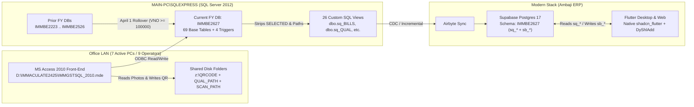
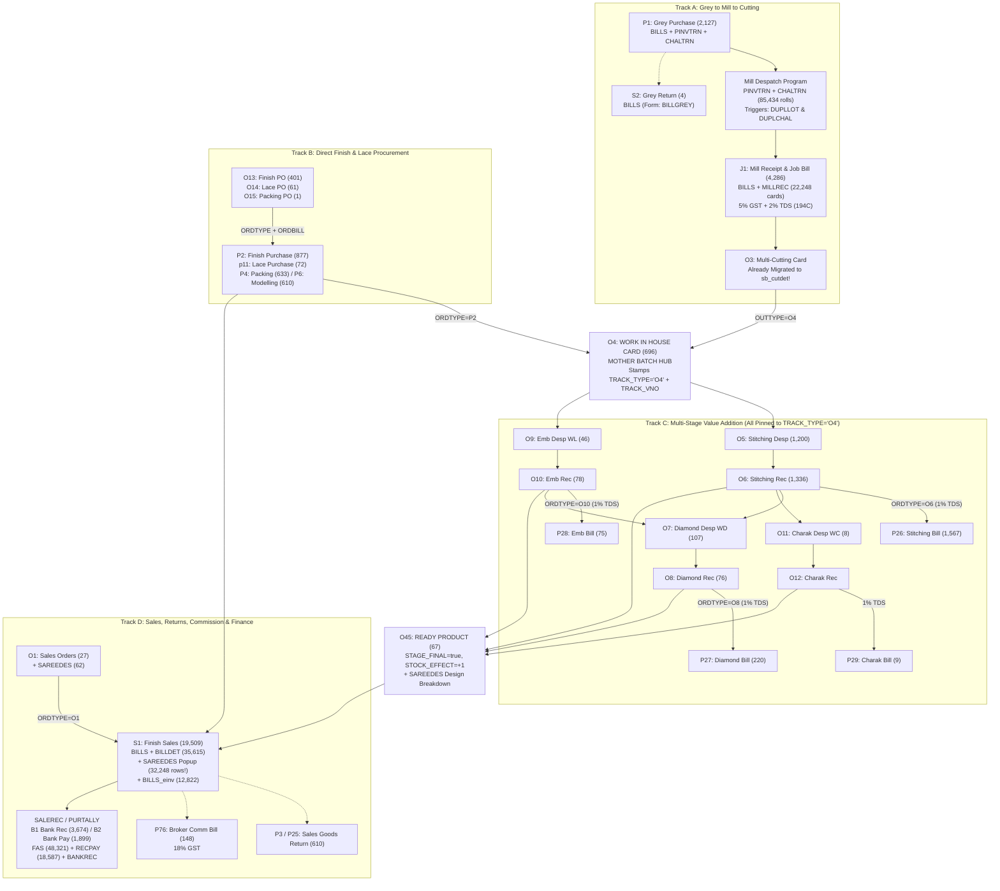

# Empire (AMAZE / IMMACULATE) Master System Blueprint

Synthesized from your three `MAIN-PC\SQLEXPRESS` exports ([`1.CSV`](file:///c:/Users/smitt/.gemini/antigravity/scratch/textile_erp/docs/empire_intake/1.CSV), [`2.CSV`](file:///c:/Users/smitt/.gemini/antigravity/scratch/textile_erp/docs/empire_intake/2.CSV), [`3.CSV`](file:///c:/Users/smitt/.gemini/antigravity/scratch/textile_erp/docs/empire_intake/3.CSV)) and verified against live Supabase `"IMMBE2627"`.

> [!IMPORTANT]
> **Headline Takeaway for Your 15-Day Sprint**: Empire is **not** a massive 93-screen custom codebase. Under the hood, it is a compiled **Microsoft Access 2010 `.mde` file** (`D:\IMMACULATE2425\IMMGSTSQL_2010.mde`) that reuses **just 6 polymorphic entry forms** (`CHALLAN`, `PURBILL`, `JOBBILL`, `BILLSDIR`, `SALEREC`, `CUTDET3`) dynamically mutated by `1,055` rows in `dbo.formsettings`—the exact same philosophy as your Flutter `Dynamic AI` (`DyShlAdd`) engine!

---

## 1. Physical Architecture & Multi-Year Rollover Engine



### How the April 1st Financial Year Switch Works
1. **Database-per-Year**: Every April 1st, Empire creates a new SQL Server database (`IMMBE2627` cloned from `IMMBE2526`, recorded in `CONFIG.ONLINEBACKENDPATH = IMMBE2526`) and locks prior-year edits (`FREEZE_ENTRY_DATE = 2026-03-31`).
2. **How Open Vouchers Cross Financial Years (`VNO >= 100000`)**: Every unclosed bill, purchase order, or jobwork challan (`CLOSED != 'Y'`) is copied into the new year's `dbo.BILLS` / `dbo.BILLDET` with an age prefix (`10xxxx` = 1 yr ago, `20xxxx` = 2 yrs ago, up to `80xxxx`!). Out of **38,873 rows** in `sq_BILLS` today, **15,300+ rows** are carried-over open vouchers from prior years.
3. **Opening Ledger & Stock**: Ledger balances roll into `FAS` as `TYPE = '00'` (`1,219` rows), while Finish Stock rolls into `QOPSTOCK` and `BILLS` `TYPE = 'O44'` (`OPENING STOCK FINISH`).

> [!WARNING]
> **Critical April 1, 2027 Airbyte Trap Discovered in `3.CSV`**: Airbyte is **not** reading `dbo.BILLS` directly—it reads **26 custom SQL Views (`dbo.sq_*`)** created inside `IMMBE2627`. When Empire creates `IMMBE2728` on April 1, 2027, Empire only clones its own 69 base tables, **not** custom `dbo.sq_*` views! If Empire is still partially running on April 1, 2027, we now have all 26 view definitions saved in `3.CSV` to recreate them in 5 seconds.

---

## 2. Complete End-to-End Textile Pipeline & Voucher State Machine

From `sq_SERIES` (`INTYPE` $\rightarrow$ `OUTTYPE`) and `sq_BILLDET` (`TRACK_*`, `STAGE_*`, `ORD*`), here is the **exact, verified workflow** of Ambaji Sarees:



### The 3-Pointer Tracking Secret Inside `dbo.BILLDET`
Whenever a saree moves through value-addition stages (`O4` $\rightarrow$ `O45`), `BILLDET` maintains three simultaneous foreign-key pointers:
1. **`TRACK_CNO / TRACK_TYPE / TRACK_VNO / TRACK_SRNO`**: Always points back to the **root `O4` (`WORK IN HOUSE CARD`)** batch! Even 5 hops later at Diamond Receipt (`O8`) or Ready Product (`O45`), `TRACK_TYPE = 'O4'` lets Empire aggregate the entire batch history.
2. **`STAGE_CNO / STAGE_TYPE / STAGE_VNO / STAGE_SRNO`**: Points to the **immediate previous challan** (`O5` points to `O4`; `O6` points to `O5`; `O10` points to `O9`; `O7` points to `O10` or `O6`).
3. **`ORDCNO / ORDTYPE / ORDBILL / ORDSRNO`**: Links **Commercial Invoices to Challans/POs** (`P2` $\rightarrow$ `O13`, `p11` $\rightarrow$ `O14`, `P26` $\rightarrow$ `O6`, `P27` $\rightarrow$ `O8`, `P28` $\rightarrow$ `O10`, `S1` $\rightarrow$ `O1`).

---

## 3. Ten New Learnings vs. Previous Working Theory

| # | Topic | Previous Working Theory | Actual Truth Proven by `1.CSV` / `2.CSV` / `3.CSV` |
| :- | :--- | :--- | :--- |
| **1** | **`SAREEDES` (`32,313` rows)** | Assumed to be a static "Saree Design Master" (`02_masters/sq_SAREEDES.md`). | **It is a 4th Voucher Sub-Detail Table!** Primary key is `(cno, TYPE, vno, srno, DESIGNNO)`. Holds **32,248 design-breakdown rows** underneath `S1` Sales Invoices (`10,697` bills), plus `O45` and `O1`. Sales Billing UX **must** have a fast Design-No sub-entry grid! |
| **2** | **`PURORD` (`0` rows)** | Assumed `sq_PURORD` stored Purchase Orders. | `dbo.PURORD` has **`0 rows` in FY 26-27** (`11` in 25-26). **100% of active Purchase Orders (`O13`, `O14`, `O15`, `O16`) and Sales Orders (`O1`) live in `BILLS` + `BILLDET`**! |
| **3** | **Series `P3` & `P76`** | Earlier doc ([`purchase_bills_series_breakdown.md`](file:///c:/Users/smitt/.gemini/antigravity/scratch/textile_erp/backend/schema_docs/purchase_bills_series_breakdown.md)) listed `P3` as "Yarn Purchase" and `P76` as "Purchase Debit Note". | **`P3` (`595` bills) = Sales Goods Return** (`SALES RETURN` ledger). **`P76` (`148` bills) = Broker/Agent Sales Commission Bills** (`CONFIG.purchase_comm_type = 'P76'`, 18% GST)! |
| **4** | **Credit vs. Debit Notes** | Earlier doc had `S92` as Sales Credit Note. | `P91` = **Credit Note (on Sales)**, `P92` = **Credit Note (on Purchases)**, `S91` = **Debit Note (on Sales)**, `S92` = **Debit Note (on Purchases)**, `P66`/`S66` = 194Q TDS Notes, `P77`/`S77` = TCS Notes. |
| **5** | **Series `P29` (Charak)** | Earlier doc marked `P29` as `N/A`. | `P29` (`WORK REC CHARAK BILLS`) is **active** in `IMMBE2627` with `9` bills in `sq_BILLS` and `sq_FAS` (1% TDS). |
| **6** | **LR & Grey Return Tables** | Assumed `BILLS_lr`, `BILLS_lr_inw`, `LRDET`, and `GREYRET` held transport LRs and grey returns. | All 4 tables have **`0 rows` across all 3 years**! LR details (`RRNO`, `RRDATE`, `TRANSPORT`, `PARCELS`, `CASENO`, `FREIGHT`, `EWB_NO`) live directly on `dbo.BILLS`, and Grey Returns use `BILLS` `TYPE = 'S2'`. |
| **7** | **Sub-Brands (`SCREENCOMP`)** | Treated `CNO = 4` as a single brand. | `dbo.SCREENCOMP` defines **3 commercial sub-brands**: **`AMBAJI SAREES (AS)`**, **`Manyata Fashion (MS)`** *(default packing: `CHAINBAG`)*, and **`Sai Silk (SS)`**. |
| **8** | **Unstreamed UX Goldmines** | Thought unstreamed tables were mostly empty. | `LABELS` has **`1,310` thermal/box label presets**; `RMKLIST` has **`556` operator quick-remarks** (232 staff/counters, 230 banks, 80 zari/patta patterns, 14 Cutting Masters); `USERS` lists all **9 active operators**! |
| **9** | **Hidden MSSQL Triggers** | Unaware of database triggers. | `PINVTRN` enforces **`DUPLLOT`** (no duplicate `CNO+TYPE+MILL+LOT`) and **`DUPLCHAL`** (no duplicate `CNO+TYPE+DESPNO+DESPNO_CHR`). `MASTER` cascades `CODE` (Name) edits to `FAS`. |
| **10** | **Proof of `sb_cutdet` Adoption** | Unmeasured impact on legacy `CUTDET`. | Empire's `dbo.CUTDET` dropped from **6,735 rows (FY25-26) $\rightarrow$ 23 rows (FY26-27)**—a **99.7% migration** to your new Flutter Cutting Card module! |

---

## 4. Empire's Daily Operator Dashboard (`dbo.QUICKREPORTS`)

In `3.CSV`, `dbo.QUICKREPORTS` revealed the **exact 8 Entry Shortcuts** and **7 Report Shortcuts** pinned to every Empire user's desktop (`SWITCHBOARD`):

````carousel
### The 8 Daily Entry Buttons (`ENTRYTYPE = 'DESKTOP'`)
| Quick # | Button Caption on Empire Desktop | MS Access Form | `OPENARGS` / Series | FY 26-27 Volume |
| :-: | :--- | :--- | :--- | :--- |
| **1** | **SALE BILLING** | `CHALLAN` (+ `Sareedes`) | `S1` | 19,509 bills + 32,248 design rows |
| **2** | **GREY PURCHASE / MILL DESPATCH** | `PURBILL` | `P1` | 2,127 bills / 85,434 takas |
| **3** | **BILL-WISE RECEIPTS / PAYMENTS** | `SALEREC` | `B1 / B2 / C1 / C2` | 18,587 `RECPAY` allocations |
| **4** | **MILL DESPATCH ENTRY** | `PINVTRN` | Mill Programs | 9,282 program cards |
| **5** | **MILL REC ENTRY** | `JOBBILL` | `J1` | 4,286 bills / 22,248 cards |
| **6** | **MULTI-CUTTING CARD** | `CUTDET3` | `O3` | *Migrated to Flutter `ScrCcForm`!* |
| **7** | **BILLS / VOUCHERS PRINTING** | `RDOC` | `QUICK` | Bulk Challan / Invoice print |
| **8** | **WORK IN HOUSE CARD** | `CHALLAN` | `O4` (and `O5`–`O12`) | 696 mother cards + 2,900+ JW docs |
<!-- slide -->
### The 7 Daily Pinned Reports (`ENTRYTYPE = 'QUICK'`)
| Quick # | Pinned Report Caption | Underlying Engine | Key Business Purpose |
| :-: | :--- | :--- | :--- |
| **1** | **PARTY-WISE OUTSTANDING BILLS** | `RBILLDAYS` (`S`) | Debtors aging & unadjusted receipts (`XX`) |
| **2** | **MILL - DESPATCH REPORT** | `RMILLDES` | Pending grey takas sitting at dyeing/printing mills |
| **3** | **MILL - RECEIPT DETAILS** | `RCOSTING` | Finished meters/pieces received vs. wastage |
| **4** | **DETAILED DESPATCH CUST. WISE** | `RBILLDET` | Customer-wise item & design sales history |
| **5** | **GREY RECEIPT REPORT** | `RMILLDES` | Weaver inward lot & checker register |
| **6** | **SCREEN DESPATCH** | `RBILLDET` | Sub-brand (`AS` / `MS` / `SS`) & quality sales velocity |
| **7** | **PAYMENT PERFORMANCE REPORT** | `RBILLDAYS` (`S1`) | Actual days taken to pay + Dhara/Vatav/Discounts deducted |
````

---

## 5. Physical Disk & Hardware Ecosystem (`Z:\` $\rightarrow$ `\\Main-pc\d` Decoded)

Read-only inspection of `Z:\` (`\\Main-pc\d`) revealed **7 critical "outside-SQL" workflows** that complete our 360° blueprint of how operators work every day:

| Folder / Binary on `Z:\` | What It Actually Is | Daily Operator Workflow Today | How Ambaji ERP (`Flutter + Supabase`) Upgrades It |
| :--- | :--- | :--- | :--- |
| **`Z:\IMMACULATE2425\EMPIRE_2010.mde`** *(27 MB)* $\rightarrow$ **`IMMGSTSQL_2010.mde`** *(104 MB)* | Two-stage MS Access 2010 app + `dongal.txt` license check + `capslock.exe` / `numlock.exe` | Operators launch `EMPIRE_2010.mde`, which forces `CAPS LOCK` + `NUM LOCK` ON and opens the 104 MB `IMMGSTSQL_2010.mde` engine. | Native Windows/Web Flutter app with automatic uppercase input formatters and `NumPad Enter` traversal—zero `.ldb` file locks! |
| **`Z:\QRCODE\2627_4_S1_<VNO>.jpg`** + `qrgen.exe` | E-Invoice QR image generator (`e.g. 2627_4_S1_13520.jpg`) | Empire runs `qrgen.exe` on every `S1` bill to save a `.jpg` on `Z:\QRCODE\` so Access reports can print the QR code. | Render crisp vector QR codes **in-memory** directly from `sq_BILLS_einv` / `sb_`—zero disk clutter! |
| **`Z:\IMMACULATE2425\EINV\`**, **`EWB\`** & **`*_GSTR1_*`** | GST Portal bridge files (`AS3_*.json`, `temp_ewb.CSV`, `B2B.CSV`, `CDNR.CSV`, `HSN1.CSV`) | Operators export JSON/CSV/XLS files to disk, upload them manually to NIC E-Invoice / E-Waybill / GSTR-1 portals, and import `UploadedInvoiceDetails.xlsx` back. | One-click clean GSTR-1 / E-Invoice JSON export (or direct GSP Edge Function API) with zero temp file mess. |
| **`Z:\LABEL SOFTWARE\`** + **`Z:\00 Scanner\Stickers\NEW AUGUST SE\*.btw`** | **BarTender UltraLite** + **TSC Thermal Printer** templates (`18 CARAT.btw`, `AGNI FX.btw`, `paithani silk.btw`) | Alongside Empire's `dbo.LABELS` (`1,310` rows), staff open quality-specific `.btw` BarTender files to print Saree/Box stickers on TSC printers. | Unified Box/Saree Sticker Designer & direct TSC/PDF thermal printing tied straight to `QUAL` and Cutting/Packing! |
| **`Z:\00 Scanner\2026-27 BILTY & CHALLAN SCANS\`** + `CZUR Shine.exe` | Overhead high-speed scanner archiving `\BILTY\` & `\CHALLAN\` by date (`08.NOV.-26\02-11-26`) | Every evening, physical Transport LRs (Bilties) & signed Challans are scanned into date folders—completely unlinked from the SQL bill! | Auto-link / drag-and-drop CZUR Bilty & Challan scans directly onto the `S1` / `O5` voucher via `sb_media`! |
| **`Z:\PHOTO\<Seq><MMSS>.jpg`** *(e.g. `3484045.jpg`, 27 KB)* | Live webcam snapshots (`cmd_view_webcam` on `O4` / Gate-Pass) | Captures ~27 KB webcam frames on disk during Gate-Pass / Work In-House (`O4`) entry. | Native camera/file capture directly into Supabase Storage (`sb_media`). |
| **`Z:\00 Broadcast\`** | `AS Price List.pdf`, `Box`/`Pouch` photos & WhatsApp bulk sender | Manual PDF price lists & WhatsApp broadcast tool (`TIGER VIKRAM`). | Live shareable catalog/price-list PDFs & WhatsApp dispatch notifications straight from the ERP. |

---

## 6. Hidden Engine Formulas Decoded from `IMMGSTSQL_2010.mde` & `EMPIRE_2010.mde`

By safely parsing the **3,863 embedded Jet 4.0 SQL queries and expressions** inside `IMMGSTSQL_2010.mde` (`115 MB`) and `EMPIRE_2010.mde` (`27 MB`) with zero file locks on `Z:\`, we uncovered **9 critical business rules** that exist *nowhere* in SQL Server views:

1. **Exact Per-Saree Costing Formula + 24% p.a. Mill Holding Interest (`[0014]`)**:
   Empire computes both **Standard Saree Cost** (net of `GREY_DISC` & `MILL_DISC`) and **Working-Capital Loaded Cost** (charging `2% per month` = `24% p.a.` interest via `/ 1500` on grey value for every day the lot sits in the mill from `Nz(WCHDAT, DDATE)` to `CUTDATE`), deducting salvage value of `OUTCUT`, `SECONDS`, and `FENT_WT * FENT_RATE`, and dividing strictly by **Fresh Pieces (`CPCS - SECONDS`)**:
   $$\text{Cost/Pc} = \frac{\text{GreyCost} + (\text{RMTS} - \text{FoldDiff}) \times \text{JobRate} - \text{Salvage}_{\text{Outcut+Sec+Fent}} + \frac{\text{WMTS} \times \text{Rate} \times \text{DaysInMill}}{1500}}{\text{CPCS} - \text{SECONDS}} + \text{AddOth}_1 + \text{AddOth}_2$$
   It compares this against **Net Realized Selling Price**: `CUTDET.Sell1 * (1 - CUTDET.dhara / 100) - packadd`.
2. **The `90%` & `< 40 Pcs` Auto-Completion Tolerance Rule (`[0015]`)**:
   Orders (`O13`–`O16`, `O1`) and stages treat remaining pendency as `0` (`ACTCOMPLETED = TRUE`) even when `CLOSED != 'Y'` if:
   - **Piece items (`UNIT = 'PCS'`)**: `(SUMPCS / PCS > 0.90 AND PCS - SUMPCS < 40)` OR `(PCS - SUMPCS < 2 AND PCS > 1)`.
   - **Meter items (`UNIT = 'MTS'`)**: `SUMMTS / MTS > 0.90` (unless `ORDER_EXACT_QTY = TRUE`).
3. **Mystery of `TYPE = 'XX'` (`1,923` rows in `sq_BILLS`) Solved (`[0009]`, `[0020]`)**:
   `TYPE = 'XX'` is **never entered by an operator**. Empire auto-generates `XX` rows in `BILLS` from unadjusted Bank (`B*`), Cash (`C*`), and Journal (`J2`) ledger credits (`FAS` minus `RECPAY`) using deterministic synthetic `VNO`s (`80000+` for `J2`, `10000–60000+` for `B1/B2/C1/C2`) so Party Outstanding (`RBILLSOUT`) automatically nets out on-account advance payments!
4. **CGST/SGST vs. IGST Column Encoding (`[0005]`, `[0021]`)**:
   - **Intra-State (Gujarat)**: `VATRATE = 2.5` (`VATAMT` = CGST) and `ADD_VATRATE = 2.5` (`ADD_VATAMT` = SGST).
   - **Inter-State (IGST)**: `VATRATE = 5.0` (`VATAMT` = full IGST) and `ADD_VATRATE = 0, ADD_VATAMT = 0`.
5. **How Root `O4` Mother Batches Actually Close (`[0016]`)**:
   Intermediate value-addition challans (`O5`$\rightarrow$`O6` Stitching, `O9`$\rightarrow$`O10` Embroidery, `O7`$\rightarrow$`O8` Diamond) advance `STAGE_*`, while root `O4` (`WORK IN HOUSE CARD`) pendency only deducts vouchers where **`BILLDET.STAGE_FINAL <> 0`** (`O45` Ready Product) grouped by `TRACK_CNO, TRACK_TYPE, TRACK_VNO, TRACK_SRNO`!
6. **Finish Stock Engine (`STOCKUNION`, `[0010]` & `[0062]`)**:
   Live Finish Stock is a 3-way `UNION ALL` of: (a) `QOPSTOCK` (`TYPE = '00'`), (b) `MILLREC`/`CUTDET` (`FRESH_PCS = CPCS - LOST`), and (c) `BILLDET * SERIES.STOCK_EFFECT` (`+1` for `P2`/`P3`/`O45`, `-1` for `S1`, substituting `ALTQUAL` over `QUAL` whenever `ALTQUAL <> ''`). On April 1 rollover, `STOCKUNION` collapses into `QOPSTOCK` under `'OPENING FINISH STOCK'`.
7. **Set-Multiplier Shorthand (`'5*4'`) & Section 194Q TDS (`[0001]`, `[0046]`)**:
   - In `S1` Sales (`BILLDET.DETAILS`), typing `'5*4'` means **5 sarees/set × 4 sets = auto-calculates `20` pcs**!
   - Section 194Q / TDS checks cumulative party turnover `> 50,00,000` (₹50 Lakhs), applying `0.1%` if `MASTER.PNRNO` (PAN) is present or `5%` penalty if blank, rounded via `CEILING`.
8. **5-Column Split E-Invoice QR JWTs (`[0034]`, `[0323]`)**:
   Because legacy `varchar(250)` columns couldn't fit NIC's ~900-char signed E-Invoice JWT, `BILLS_einv` splits the QR payload across **`QRCODE1` + `QRCODE2` + `QRCODE3` + `QRCODE4` + `QRCODE5`** before passing it to `qrgen.exe`.
9. **LAN Workstation $\rightarrow$ Operator Desk Map & April 1 Offset Math (`EMPIRE_2010.mde`, `[0020]`)**:
   - Connects via TCP port **`1092`** (`MAIN-PC\SQLEXPRESS,1092`). Desk map: `MAIN-PC` (`ARVIND`/`DEEPAK`), `SALES` & `JATINLOQ` (`JATIN`), `NODE-PC` (`GIRDHARI`), `DESKTOP-MGN160B` (`ROSHAN`), `DESKTOP-MVJLLV9` (`AKSHAY`), `SOBER_YOGA` (`SUBHAM`).
   - April 1 rollover appends `'*'` to `BILL`/`LOT`/`WCHAL`, adds `+100000` to `VNO`/`CARDNO`/`DESPNO`, and shifts `CHALTRN.SRNO - 1000000` & `BILLDET.SRNO - 200000`.

> [!TIP]
> **100% Ready for Empire Screenshots!** All three layers—**SQL Server (`IMMBE2627`)**, **Disk/Hardware (`Z:\`)**, and **Compiled `.mde` Business Formulas (`IMMGSTSQL_2010.mde`)**—are completely decoded. Share your Empire UI screenshots whenever you're ready!
