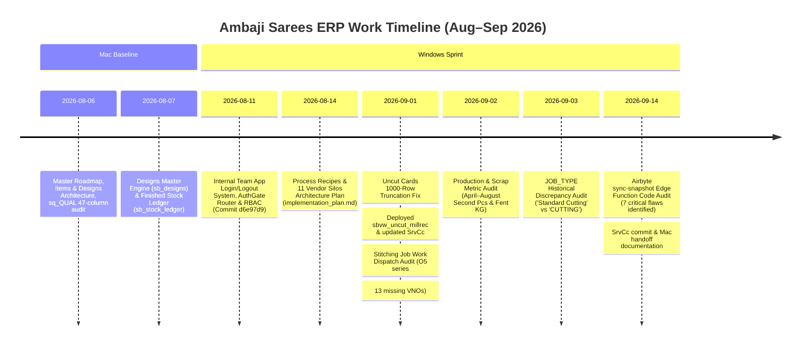

# Ambaji Sarees ERP — Work Gap & Project State Summary (August–September 2026)

> **Document Scope**: Complete cross-machine handover, historical work consolidation, database migrations, and operational state report  
> **Origin**: Generated on Windows Workstation (`2026-09-14`) for seamless resumption on MacBook Workstation  
> **Current Target Branch**: `master` (`origin/master`)  
> **Schema Context**: `IMMBE2627` in Supabase Postgres 17  
> **Flutter Baseline**: Flutter 3.x (Windows Desktop Primary / macOS Secondary)  

---

## 1. Executive Summary & Timeline Overview

Between **6 August 2026** (last active commit on MacBook Workstation `de15ea2` / `b38d716`) and **14 September 2026**, several critical architectural modules, database views, data audits, and bug fixes were completed on the Windows Workstation. 

This document bridges the entire work gap to give you a single, unified view of the application state before pushing off to work on macOS for the next 2–3 days.



---

## 2. Detailed Work Completed (August 11 – September 14, 2026)

### A. Internal Team App Login & RBAC System (Commit `d6e97d9`)
* **Admin Login Screen (`lib/screens/admin/auth/scr_admin_auth_login.dart`)**:
  * Dual-pane landing screen with ambient brand showcase, telemetry pills, and account shortcuts (`sub.ambaji@gmail.com`, `jatin.mitfam@gmail.com`).
  * Native `shadcn_flutter` components with email/password authentication, password visibility toggle, and light/dark theme switcher.
* **Top-Level Reactive AuthGate Router (`lib/screens/admin/auth/scr_auth_gate.dart`)**:
  * Listens to Supabase `onAuthStateChange` streams.
  * Dynamically switches between `ScrAdminAuthLogin` (unauthenticated) and `HomeScreen` (authenticated).
* **Inactivity Auto-Logout Tracker (`lib/services/admin/srv_inactivity_tracker.dart`)**:
  * 60-minute inactivity timer engine (`InactivityWrapper`) that tracks mouse/keyboard events and logs out dormant sessions.
* **RBAC & User Profile Integration (`lib/models/admin/mdl_auth.dart`, `lib/services/admin/srv_auth.dart`)**:
  * `AppProfileModel` & `UserRoleModel` resolving roles (`OWNER`, `ADMIN`, `MANAGER`, `STAFF`).
  * Integrated header profile popover in `home.dart` displaying dynamic user name, role badge, avatar initials, and one-click Sign Out.

---

### B. Process Recipes, Dedicated Mill Matrix & Instant PO Architecture
* **Architectural Specification (`docs/architecture/process_recipes_and_cost_masters_architecture.md` / `implementation_plan.md`)**:
  * **11 Vendor & Process Silos**: Unified polymorphic schema (`sb_recipe_masters` + `sb_recipe_rates`) with JSONB spec payloads for Mills, Outside Print, Finish Purchase, Blouse, Grey Weavers, Lace, Digital Print, Packing, Stitching/Diamond, Brokerage, and Charak.
  * **Dedicated Processing Mill Engine (`sb_mill_recipes` + `sb_mill_rate_slabs`)**:
    * Relational 2D matrix for user-creatable `job_type` $\times$ `value_type` cross-rates.
    * Multi-quality fabric bindings (`sq_QUAL.qcode` JSONB array).
    * Volume tiered slab rates (`min_recmtrs` threshold).
  * **Stitching & Diamond Composite Calculation Engine (`sb_stitching_diamond_recipes`)**:
    * Composite calculation combining Base Stitching Rate + Diamond Stone Rate ($\text{Rate}/1000 \text{ stones} \times \text{Count}$) + Lace Attachment Rate.
  * **Item Default Recipes (`sb_item_default_recipes`)**:
    * Binds default recipe stacks to Items (`sq_QUAL` / `ext_sb_qual`) to auto-populate recommended recipes when creating production jobs.
  * **Instant PO Engine**:
    * Generates itemized Purchase Orders (`sb_purchase_orders`) per vendor directly from Job Work Cards (`sb_job_ext`).

---

### C. Cutting Cards 1,000-Row Truncation Bug Fix & `sbvw_uncut_millrec` View
* **The Problem**:
  * In the **Add Cutting Card** workstation, incoming uncut fabrics from **`JAY TEX SILK MILLS`** (May 4th, VNOs 212–219, Cut Report 91) and **`AAISWARYA DYEING MILLS PVT LTD`** (May 4th, 12 uncut cards of `DULL MOSS (MUSKAN PATTA VISCOSE)`, Cut Card 92) were completely missing from the mill selector and uncut cards table.
  * **Root Cause**: `sq_MILLREC` contains 5,437 rows for current fiscal year (`VNO < 100000`). Supabase PostgREST endpoints enforce a strict default **1,000-row API response limit**. Ordering by `VNO DESC` returned only records down to ~VNO 600 (June–August), truncating all May entries at row index ~1,450.
* **The Fix**:
  * **Database View**: Created `IMMBE2627.sbvw_uncut_millrec` in Supabase Postgres 17:
    ```sql
    CREATE OR REPLACE VIEW "IMMBE2627"."sbvw_uncut_millrec" AS
    SELECT m.*
    FROM "IMMBE2627"."sq_MILLREC" m
    LEFT JOIN "IMMBE2627"."sb_cutdet" c ON m."RECCARDNO" = c.reccardno
    WHERE c.reccardno IS NULL
      AND m."MILL_CODE" IS NOT NULL
      AND m."VNO" < 100000;
    ```
    This filters out 5,000+ cut cards on the Postgres server, returning **only active uncut cards** (approx. 200–300 rows total) with 0 API truncation!
  * **Flutter Service Layer (`lib/services/production/srv_cc.dart`)**:
    * Updated `getMillOptions()` and `getDistinctMillsFromMillrec()` to query `sbvw_uncut_millrec`.
    * Updated `getUncutCardMapsByMill()` and `getUncutCardsByMill()` to query `sbvw_uncut_millrec` in FIFO order (`CUTDATE ASC`, `RECCARDNO ASC`).
    * Refactored `sq_PINVTRN` grey rate joining using exact `CARDNO` foreign key with query chunking (400 IDs per chunk) and fallback to `sq_BILLS`.
  * **Verification**: `flutter analyze` completed with **0 errors, 0 warnings**.

---

### D. Production & Billing Database Audits

#### 1. Missing Serial Numbers in `sb_cutdet_summary` (`MULTI_VNO` 1 to 493)
* **Total Present**: 469 reports.
* **Total Missing**: 24 sequence gaps identified:
  * `12`, `56`, `59`, `86`, `91`, `92`, `94`, `95`, `133`, `326`, `369`, `399`, `414`, `433`, `437`, `443`, `458`, `477`, `478`, `485`, `489`, `490`, `491`, `492`.
* **Detail Card Gaps in `sb_cutdet` (`CUTCARDNO` 1 to 5032)**:
  * Missing: `876`–`896` (21 cards) and `3140`–`3141` (2 cards).

#### 2. Stitching Job Work Dispatch Audit (`sq_BILLS`, Company `CNO = 4`)
* **`TYPE = 'O5'` (Stitching Dispatch)**: Min VNO `1`, Max VNO `509`, 496 present.
  * **13 Missing VNOs**: `84`, `85`, `86`, `87`, `88`, `135`, `238`, `321`, `325`, `329`, `332`, `371`, `508`.
* **`TYPE = 'O4'` (Series O4 Dispatch)**: Min VNO `1`, Max VNO `94`. **0 missing** (100% complete sequence 1–94).
* **`TYPE = 'O6'` (Stitching Receipt)**: Min VNO `1`, Max VNO `497`. **0 missing** (100% complete sequence 1–497).

#### 3. Monthly Production & Scrap Metrics (`sb_cutdet_summary`)
* **April 2026**: 4,366 second pcs | 1,352.47 kg fent (19,239 m) | 141,849 fresh pcs (81 reports, VNOs 1–84)
* **May 2026**: 3,398 second pcs | 900.16 kg fent (13,444 m) | 99,544 fresh pcs (60 reports, VNOs 85–146)
* **June 2026**: 5,738 second pcs | 1,488.40 kg fent (21,552 m) | 143,670 fresh pcs (102 reports, VNOs 147–248)
* **July 2026**: 5,208 second pcs | 1,400.03 kg fent (21,176 m) | 141,559 fresh pcs (104 reports, VNOs 249–377)
* **August 2026**: 7,499 second pcs | 2,149.15 kg fent (29,718 m) | 192,972 fresh pcs (126 reports, VNOs 320–493)
* **Unit Convention**: Column `TOTAL_FENT_WT` is stored in **grams** in the database; divided by 1,000 for **Kilograms (KG)**.

#### 4. `JOB_TYPE` Historical Discrepancy Audit in `sb_cutdet_summary`
* **`Standard Cutting` (307 reports)**: Saved by earlier app versions from April 1 to July 24 (`MULTI_VNO` 1 to 329).
* **`CUTTING` (166 reports)**: Saved by newer app versions from July 25 to August 27 (`MULTI_VNO` 335 to 493).
* **Operational Action Required**: Ensure all queries filter with `.inFilter('JOB_TYPE', ['Standard Cutting', 'CUTTING'])` to prevent missing either historical cohort.

---

### E. Airbyte `sync-snapshot` Edge Function Code Review
* **File**: `backend/supabase/functions/sync-snapshot/index.ts`
* **7 Critical Issues Identified**:
  1. `BigInt` serialization crash in `sql.json(...)` (breaks on bigint columns).
  2. Overly broad first-word matching in `isFuzzyMatch` (e.g. false rename matches on `"SHREE"`, `"PVT"`).
  3. `sql.unsafe` raw string interpolation instead of parameterized identifiers.
  4. Connection pool leak / double-close edge case in `sql.end()`.
  5. Missing `SUPABASE_DB_URL` environment variable assertion.
  6. Edge Function 150MB memory & 10s CPU timeout risks when processing 7 large tables sequentially.
  7. Null fallback evaluating to literal `"null"` string in `ghostName`.

---

## 3. Current Git & Application Health

| Area | Status | Notes |
| :--- | :--- | :--- |
| **Git Branch** | `master` | Clean working tree; all fixes committed. |
| **Flutter Static Analysis** | **0 errors, 0 warnings** | Clean run via `flutter analyze`. |
| **Database Migrations** | **Live** | `IMMBE2627.sbvw_uncut_millrec` active and verified. |
| **Authentication** | **Protected** | `ScrAuthGate` guards the application root in `main.dart`. |

---

## 4. MacBook Workstation Transition Checklist (Next 2–3 Days)

Follow these exact steps when switching back to your Mac:

```bash
# 1. Pull latest master commits from remote
cd ~/path/to/textile_erp
git checkout master
git pull origin master

# 2. Refresh dependencies (DO NOT RUN flutter upgrade!)
cd frontend
flutter pub get

# 3. Run static analysis to verify local Dart SDK
flutter analyze

# 4. Run the desktop app on macOS
flutter run -d macos
```

### 🎯 Key Focus Areas for Mac Workstation:
1. **Recipe Masters UI Workstation**:
   * Implement UI screens for the 11 vendor silos mapped in `docs/architecture/process_recipes_and_cost_masters_architecture.md`.
2. **`sync-snapshot` Edge Function Fixes**:
   * Refactor `backend/supabase/functions/sync-snapshot/index.ts` to resolve the 7 identified issues (BigInt replacer, proper Levenshtein similarity, safe `finally` connection cleanup).
3. **`JOB_TYPE` Standardization Migration**:
   * Execute migration to standardize historical `'Standard Cutting'` strings to `'CUTTING'` in `sb_cutdet_summary`.
